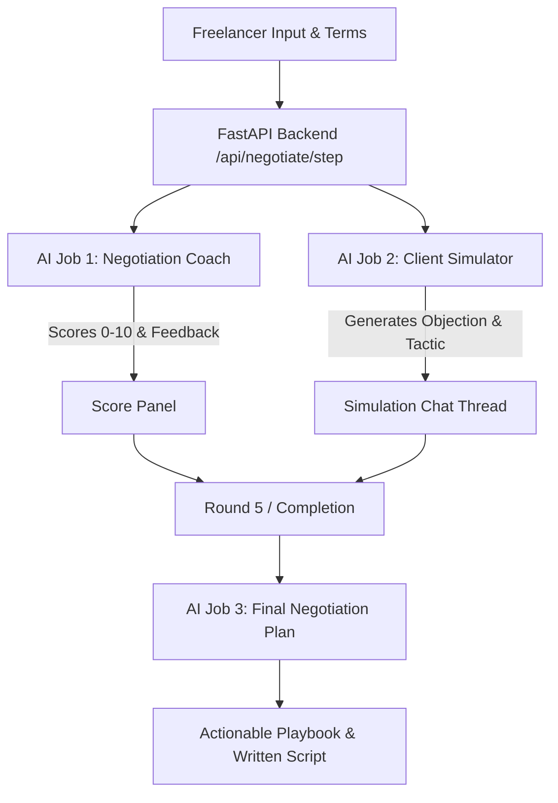

# DealGuard

> **DealGuard** is a private, local-first negotiation simulator for freelancers. Paste a real client enquiry, set your price and boundaries, and rehearse the conversation with an open-weight AI model before the actual negotiation. Your client messages, pricing, and negotiation history stay on your machine.

---

## 🎯 Product Definition

Freelancers lose thousands in billable revenue and suffer from "scope creep" because they are forced to negotiate in real time under pressure without preparation.

**DealGuard** solves this by providing a local rehearsal arena:
1. **Paste Client Message**: Enter the client's initial email, message, or project brief.
2. **Define Boundaries**: State your quoted price, minimum acceptable floor rate, deadline, and strict non-negotiables.
3. **Simulate Difficult Objections**: DealGuard plays a realistic, persistent client for up to 5 rounds, challenging your rates and testing your boundaries.
4. **Live Turn-by-Turn Coaching**: With every counter-reply, DealGuard scores:
   - 🛡️ **Price Defence** (0–10)
   - 📐 **Scope Protection** (0–10)
   - 💼 **Professional Tone** (0–10)
   - ⚠️ **Overcommitment Risk** (0–10, where 10 = critical danger)
5. **Final Negotiation Plan**: Generates an actionable negotiation playbook with an anchor price, boundaries to put in writing, identified traps, and a ready-to-send reply script.

---

## 🏗️ Architecture & Dual-AI Pipeline

Rather than relying on a single monolithic prompt, DealGuard splits the AI workload into two focused jobs using Ollama structured JSON outputs:



---

## ⚡ Tech Stack

- **Backend**: Python 3.11+ / FastAPI / Uvicorn / Pydantic
- **Frontend**: Clean Vanilla Modern CSS Design System + Vanilla JS (Zero build step, ultra-fast, high aesthetic dark mode)
- **Local Model**: Gemma 3 via Ollama (`http://localhost:11434/api/chat` with structured `format: "json"`)
- **Data Persistence**: Browser `localStorage` for complete local-first privacy.

---

## 🚀 Quickstart Guide

### 1. Prerequisites: Install & Run Ollama with Gemma 3

```bash
# Pull and run Gemma 3 locally
ollama pull gemma3
ollama run gemma3
```
*Note: If Ollama is offline or still downloading, DealGuard automatically activates an offline heuristic simulation engine so you can immediately rehearse and test without interruption.*

### 2. Backend Setup

```bash
# Navigate to backend
cd dealguard/backend

# Install dependencies
pip install -r requirements.txt

# Run the FastAPI server
python -m uvicorn main:app --reload --port 8000
```

### 3. Open the App

Open your browser to:
👉 **`http://localhost:8000`**

---

## 🎬 Rehearsal Demo Walkthrough (Exact Script)

Test this realistic high-stakes scenario using the **"⚡ Load Demo Scenario"** button in DealGuard:

1. **Client's Initial Message**:
   > *"Hi, I need a 5-page website with booking, payments, and SEO. My budget is ₹8,000. I need it in 3 days."*
2. **Freelancer Quote**: `₹25,000`
3. **Minimum Acceptable Floor**: `₹18,000`
4. **Deadline**: `7 business days`
5. **Non-Negotiables**:
   - `50% advance payment required`
   - `7-day turnaround timeline`
   - `Revisions strictly limited to two rounds`

### Rehearsal Rounds & Coach Reactions:

- **Round 1 — Comparison Pressure**:
  - *Client Objection*: *"Another developer on Upwork said ₹10,000 for this exact setup. Why is your price so high?"*
  - *Freelancer Counter*: *"My rate reflects production-ready code with secure payment gateways and QA testing. If ₹8k is your ceiling, we can do 1 landing page without payment integrations."*
  - *DealGuard Score*: Price Defence 9/10, Scope Protection 9/10.

- **Round 2 — Scope Creep Attack**:
  - *Client Objection*: *"Can you include free 1-year hosting and unlimited revisions if I pay tomorrow?"*
  - *Test Concession Reply*: *"Sure, I can include unlimited revisions."*
  - *Coach Flag*: ⚠️ **Critical Warning: Overcommitment Risk 9/10!** Accepts scope creep. Suggested fix: strictly limit to 2 rounds, separate hosting costs.

- **Round 3 — Urgency**:
  - *Client Objection*: *"I have budget approved and can pay 50% tomorrow if you start today and finish by Sunday."*
  - *Freelancer Stance*: Defend the 7-day sprint and advance contract sign-off.

- **Final Step — Negotiation Playbook**:
  - Recommended Price: `₹22,000`
  - Boundaries in writing: 50% deposit, 2 revision rounds cap, 7-day schedule.
  - Ready-to-copy client reply text.

---

## 📁 Repository Structure

```
.
├── backend/
│   ├── main.py             # FastAPI entrypoint, routes & static file serving
│   ├── schemas.py          # Pydantic data contracts (DealSetup, ClientTurn, etc.)
│   ├── ollama_client.py    # Local Ollama client with JSON parsing & fallback engine
│   ├── prompts.py          # Separated prompts for Client simulator, Coach, and Plan
│   └── requirements.txt    # Python dependencies
├── frontend/
│   ├── index.html          # Semantic 4-screen application layout
│   ├── app.js              # State machine, chat thread & live scoring
│   └── style.css           # Modern dark-mode UI with emerald accents
├── run.py                  # One-click launcher script
├── test_dealguard.py       # Automated test suite
├── DEV_ARTICLE.md          # Ready-to-publish DEV.to community article
├── README.md               # Product documentation & walkthrough
└── LICENSE                 # Open-source MIT License
```

---

## 🔒 Privacy & Local-First Philosophy

All negotiations, pricing figures, client inquiries, and rehearsal logs remain 100% on your local hardware. No remote telemetry, no third-party cloud LLM API keys required.

---

## 📄 License

MIT License. See [LICENSE](LICENSE) for details.
